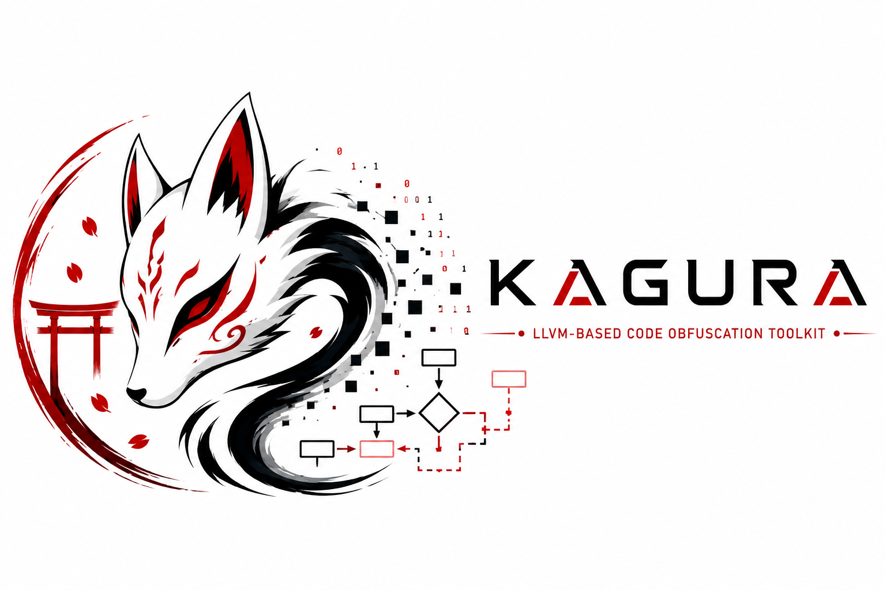

<p align="center">
  
</p>

<p align="center">
  <a href="https://github.com/ykus4/kagura/actions/workflows/ci.yml">
    
  </a>
  <a href="https://github.com/ykus4/kagura/actions/workflows/release.yml">
    
  </a>
  
  
  
  
</p>

# Kagura-Obf

> **来源 / Source:** 本项目源自 [ykus4/kagura](https://github.com/ykus4/kagura)（作者 yotti，MIT License），本仓库是在其源码基础上整理并修复大量空指针的修复版本，展示名为 **Kagura-Obf**；插件文件名 `KaguraObfuscator.*` 与 `-kagura-*` 参数保持不变，以兼容上游。上游研究见 [Zenodo 10.5281/zenodo.20361447](https://doi.org/10.5281/zenodo.20361447)。

**English** | [简体中文](#简体中文)

Kagura-Obf is an **OLLVM-style (Obfuscator-LLVM) code obfuscation and anti-tamper toolkit for C code**. It runs as a standard LLVM pass plugin on the New Pass Manager, so the same protection works for C (and C++) sources on Linux, Windows, macOS, Android, iOS, and WebAssembly — without forking or patching the LLVM source tree.

> Homepage summary (formerly `docs/index.md`): LLVM-based code obfuscation and anti-tamper toolkit for mobile, desktop, and WebAssembly targets.

---

## English

### Overview

Kagura-Obf operates at the LLVM IR level, before IR is lowered to machine code. Every pass is architecture-independent, and the same `clang -fpass-plugin=...` invocation protects every target supported by the underlying LLVM build.

- **Input:** C / C++ source, or `.bc` / `.ll` bitcode
- **Integration:** New Pass Manager plugin (`-fpass-plugin=`), `opt --load-pass-plugin=`
- **LLVM API:** New Pass Manager only; no LLVM source modifications
- **Protection model:** OLLVM-style control-flow flattening, bogus control flow, instruction substitution, string/constant/global encryption, plus anti-debug and integrity checks

### Supported LLVM versions

| Item | Version |
|:-----|:--------|
| Primary target | **LLVM 17.0.6** (`llvm-project-17.0.6.src`) |
| Linux release binary | `KaguraObfuscator.so` built against `llvm-project-17.0.6.src` |
| Windows release binaries | `KaguraObfuscator.dll` built with LLVM **17.0.6** and LLVM **19.1.7** |
| Source compatibility | LLVM 17 – 22 (CI covers 17, 18, 19, 21, 22) |

A pass plugin must match the LLVM major version used by the `clang` / `opt` that loads it. Pick the binary built for your toolchain; build from source for any other version in the 17–22 range.

### Supported passes

#### Control flow (`lib/Transforms/CFG/`)

| Flag | Pass | Effect |
|:-----|:-----|:-------|
| `-kagura-fla` | ControlFlowFlattening | Converts the CFG into a switch-dispatched state machine |
| `-kagura-bcf` | BogusControlFlow | Injects dead blocks guarded by MBA opaque predicates |
| `-kagura-ibr` | IndirectBranch | Replaces direct calls with loads from function-pointer globals |
| `-kagura-ci` | CallIndirection | Routes external calls through a runtime-resolved thunk table |
| `-kagura-lt` | LoopTransform | Adds dead counters and opaque invariant branches to loops |
| `-kagura-fsplit` | FunctionSplit | Outlines interior basic blocks into helper functions |
| `-kagura-bbs` | BasicBlockSplitting | Splits large basic blocks to inflate CFG complexity |
| `-kagura-bbr` | BasicBlockReordering | Shuffles block layout to confuse linear disassemblers |
| `-kagura-dci` | DeadCodeInsertion | Inserts unreachable junk blocks |
| `-kagura-elt` | EncryptedLookupTable | Converts switch dispatch into XOR-encrypted lookup tables |
| `-kagura-vtp` | VTableProtection | Obfuscates C++ RTTI typeinfo names and records vtable metadata |

#### Data obfuscation (`lib/Transforms/Data/`)

| Flag | Pass | Effect |
|:-----|:-----|:-------|
| `-kagura-str` | StringEncryption | XOR-encrypts narrow string literals; lazy decrypt on first access |
| `-kagura-str-aes` | StringEncryptionAES | AES-128-CTR string encryption (requires runtime) |
| `-kagura-wstr` | WideStringEncryption | XOR-encrypts `wchar_t` / `char16_t` / `char32_t` strings and CFString buffers |
| `-kagura-co` | ConstantObfuscation | Replaces integer constants with MBA expressions |
| `-kagura-sub` | Substitution | Replaces arithmetic/bitwise operations with equivalent MBA forms |
| `-kagura-genc` | GlobalEncryption | Encrypts private integer globals; inlines XOR at load sites |
| `-kagura-mvo` | MemoryValueObfuscation | XOR-encrypts `alloca` integer locals at every store/load |
| `-kagura-pe` | PointerEncryption | XOR-encrypts `alloca` pointer variables |

#### Anti-analysis (`lib/Transforms/AntiAnalysis/`)

| Flag | Pass | Effect |
|:-----|:-----|:-------|
| `-kagura-anti-debug` | AntiDebug | ptrace / Frida / `/proc/maps` / hook / breakpoint / emulator checks |
| `-kagura-tamper` | AntiTamper | FNV-1a function checksums plus jailbreak/root checks at startup |
| `-kagura-pac` | PointerAuth | Software CFI through XOR-tagged function-pointer globals |
| `-kagura-sv` | SymbolVisibility | Hides non-public symbols from the dynamic symbol table |
| `-kagura-honey` | HoneyValue | Injects decoy secrets and fake security stubs |
| `-kagura-bbcheck` | BasicBlockChecksum | Per-basic-block opcode checksums; aborts on binary patching |
| `-kagura-telemetry` | Telemetry | Inserts behavioral probes at function entry |

#### Platform-specific (`lib/Transforms/Platform/`)

| Flag | Pass | Target |
|:-----|:-----|:-------|
| `-kagura-objc` | ObjCObfuscation | iOS — ObjC selector and class-name obfuscation |
| `-kagura-jni` | JNIObfuscation | Android — converts static `Java_*` exports to dynamic `RegisterNatives` |
| `-kagura-vm` | VMObfuscation | Virtualizes function bodies into a stack-based VM bytecode |

#### Infrastructure and utilities

| Flag | Pass | Effect |
|:-----|:-----|:-------|
| `-kagura-dwarf=keep\|strip\|obfuscate` | DWARFControl | Keep, strip, or remap debug information |
| `-kagura-config=<file>` | ConfigLoader | Load a JSON policy file and strength profile |
| `-kagura-symmap` | SymbolMap | Emit an original-to-obfuscated symbol map |
| `-kagura-audit` | AuditLog | Emit an audit log of protected symbols and applied passes |
| `-kagura-autoselect` | AutoSelect | Automatically select passes per function |
| `-kagura-metrics` | ObfuscationMetrics | Print BB / instruction / cyclomatic-complexity deltas |

### Tuning options

| Option | Default | Description |
|:-------|:--------|:------------|
| `-kagura-seed=<N>` | `0` (entropy) | PRNG seed for reproducible output |
| `-kagura-bcf-prob=<N>` | `30` | Bogus-CF probability per basic block, 0–100 |
| `-kagura-bcf-iter=<N>` | `1` | Bogus-CF iterations |
| `-kagura-sub-iter=<N>` | `1` | Substitution iterations |
| `-kagura-dci-prob=<N>` | `40` | Dead-code insertion probability, 0–100 |
| `-kagura-protect=<glob>` | — | Force-protect matching symbols |
| `-kagura-deny=<glob>` | — | Exclude matching symbols |
| `-kagura-allow=<glob>` | — | Allowlist mode |
| `-kagura-skip-pattern=<regex>` | — | Skip matching functions in static / LTO builds |
| `-kagura-symmap-out=<path>` | `kagura_symbols.json` | Symbol-map output path |
| `-kagura-audit-out=<path>` | `kagura_audit.json` | Audit-log output path |
| `-kagura-lto-safe` | `false` | Enable passes during LTO / ThinLTO phases |
| `-kagura-o0-protect` | `false` | Lightweight protection at `-O0` |
| `-kagura-build-id=<id>` | — | Mix a build identifier into the PRNG seed |

### Config profiles

```json
{
  "profile": "BALANCED",
  "passes": { "str": true, "fla": true, "bcf": true, "mvo": false },
  "tuning": { "bcf_prob": 40, "seed": 12345 }
}
```

| Profile | Passes | Intended use |
|:--------|:-------|:-------------|
| `FAST` | STR only | Debug / CI builds |
| `BALANCED` | STR + WSTR + BCF + BBR + BBS + GENC | Standard release builds |
| `STRONG` | All passes at maximum settings | Security-critical builds |

### Build from source

Requirements: CMake 3.20+, a C++17 compiler, and an LLVM development tree that contains `LLVMConfig.cmake`.

#### Linux (LLVM 17.0.6)

```bash
cmake -B build -G Ninja \
  -DCMAKE_BUILD_TYPE=Release \
  -DLLVM_DIR=/opt/llvm-17.0.6/lib/cmake/llvm \
  -DCMAKE_C_COMPILER=/opt/llvm-17.0.6/bin/clang \
  -DCMAKE_CXX_COMPILER=/opt/llvm-17.0.6/bin/clang++ \
  -DKAGURA_BUILD_TESTS=OFF \
  -DKAGURA_BITCODE_TOOLS=OFF \
  .
cmake --build build -j"$(nproc)"
# -> build/lib/Transforms/KaguraObfuscator.so
```

If LLVM 17.0.6 is not already installed, build it from `llvm-project-17.0.6.src`:

```bash
cmake -S llvm-project-17.0.6.src/llvm -B llvm-17.0.6-build -G Ninja \
  -DCMAKE_BUILD_TYPE=Release \
  -DLLVM_ENABLE_PROJECTS=clang \
  -DLLVM_ENABLE_PLUGINS=ON \
  -DLLVM_TARGETS_TO_BUILD="X86;ARM;AArch64"
cmake --build llvm-17.0.6-build -j"$(nproc)"
cmake --install llvm-17.0.6-build --prefix /opt/llvm-17.0.6
```

#### macOS

```bash
brew install llvm
bash build.sh
# -> build/lib/Transforms/KaguraObfuscator.dylib
```

Or point CMake at any custom LLVM build with `-DLLVM_DIR=.../lib/cmake/llvm`.

#### Windows (Clang-CL + Ninja)

```bat
build_win.bat
:: Requires the LLVM Windows dev tree (LLVMConfig.cmake) and Clang-CL.
:: -> build\lib\Transforms\KaguraObfuscator.dll
```

Manual configuration:

```bat
cmake -B build -G Ninja ^
  -DCMAKE_BUILD_TYPE=Release ^
  -DLLVM_DIR=C:\llvm-dev\lib\cmake\llvm ^
  -DCMAKE_C_COMPILER=C:\llvm-dev\bin\clang-cl.exe ^
  -DCMAKE_CXX_COMPILER=C:\llvm-dev\bin\clang-cl.exe ^
  -DKAGURA_BUILD_TESTS=OFF
cmake --build build
```

MSVC builds the plugin as a DLL exporting `llvmGetPassPluginInfo`; load it with `clang -fpass-plugin=` (or `clang-cl`) from the same LLVM installation.

### Usage (C code)

```bash
clang -fpass-plugin=/path/to/KaguraObfuscator.so \
      -mllvm -kagura-str \
      -mllvm -kagura-fla \
      -mllvm -kagura-bcf \
      -mllvm -kagura-bcf-prob=50 \
      -O1 your_file.c -o your_file
```

JSON policy (recommended for projects):

```bash
clang -fpass-plugin=/path/to/KaguraObfuscator.so \
      -mllvm -kagura-config=kagura.json \
      -O1 your_file.c -o your_file
```

Bitcode / `opt`:

```bash
clang -O1 -emit-llvm -c your_file.c -o your_file.bc
opt --load-pass-plugin=/path/to/KaguraObfuscator.so \
    -passes="kagura-str,function(kagura-fla,kagura-bcf,kagura-sub)" \
    your_file.bc -o your_file.opt.bc
clang your_file.opt.bc -o your_file
```

Per-function control with annotations:

```c
// Force-enable passes for this function
__attribute__((annotate("kagura_fla,kagura_bcf,kagura_str")))
int critical_check(const char *input) { ... }

// Force-disable one pass
__attribute__((annotate("kagura_nofla")))
void performance_sensitive(void) { ... }

// Virtualize a sensitive function
__attribute__((annotate("kagura_vm")))
int verify_license(const char *key) { ... }
```

### Prebuilt binaries

The `release/` directory in this repository contains the locally packaged plugins:

| Path | Platform | LLVM |
|:-----|:---------|:-----|
| `release/linux-x86_64-llvm17.0.6/KaguraObfuscator.so` | Linux x86_64 | 17.0.6 |
| `release/windows-x86_64-llvm17.0.6/KaguraObfuscator.dll` | Windows x86_64 | 17.0.6 |
| `release/windows-x86_64-llvm19.1.7/KaguraObfuscator.dll` | Windows x86_64 | 19.1.7 |
| `release/runtime/kagura_runtime.lib` | Windows x86_64 | LLVM-independent |
| `release/include/kagura/*.h` | All | — |

Checksums are listed in [`release/SHA256SUMS.txt`](release/SHA256SUMS.txt).

### Runtime library

Passes that emit runtime calls need `libkagura_runtime.a` (Linux/macOS) or `kagura_runtime.lib` (Windows):

| Pass | Emitted symbols | Availability |
|:-----|:----------------|:-------------|
| StringEncryptionAES | `kagura_aes128_ctr_decrypt`, `kagura_zero_buf` | Provided by `runtime/core` |
| VMObfuscation | `kagura_vm_execute` | Provided by `runtime/core` |
| AntiDebug | `kagura_anti_debug_init`, `kagura_on_tamper_detected`, `kagura_check_tracer_pid`, `kagura_check_inline_hooks`, `kagura_check_got_hooks`, `kagura_check_sw_breakpoints`, `kagura_check_hw_breakpoints`, `kagura_check_emulator` | Checks are compiled from `runtime/anti_debug` (POSIX) and `runtime/windows`; `kagura_anti_debug_init()` must be supplied by the application |
| AntiTamper | `kagura_self_check`, `kagura_tamper_detected`, `kagura_runtime_hash_check` | Provided by `runtime/ios/jailbreak_detection.c` on POSIX builds; supply your own on Windows |
| PointerAuth | `kagura_random_u64`, `kagura_init_pac_key` | Must be supplied by the application |
| CallIndirection | `dlsym` | System library |

Runtime entry points use plain C linkage; declare the ones you call. Verify what an archive actually exports before relying on it:

```bash
llvm-nm --defined-only libkagura_runtime.a | grep kagura_
```

```c
extern "C" void kagura_self_check(void);          // POSIX: integrity + root/jailbreak
extern "C" void kagura_library_scan_check(void);  // POSIX: suspicious dylib/so scan
```

### Integration

| Platform | Setup |
|:---------|:------|
| Xcode | `integration/xcode/kagura.xcconfig` + run-script phase |
| Android NDK / Gradle | `apply from: "kagura/integration/android/kagura.gradle"` |
| Unity IL2CPP | Copy `integration/unity/Editor/KaguraPostBuildProcessor.cs` to `Assets/Editor/` |
| Unreal Engine 5 | Copy `KaguraToolchain.cs` into the UBT toolchain path |
| CMake | `-DCMAKE_TOOLCHAIN_FILE=kagura-toolchain.cmake` |
| Bazel | `load("@kagura//integration/bazel:kagura.bzl", "kagura_cc_binary")` |
| CocoaPods / SPM | `KaguraRuntime` pod / package product |

See the per-platform `README.md` under `integration/`.

### Tests

```bash
cd build && ctest --output-on-failure
./scripts/differential-test.sh        # obfuscated vs. plain output
./scripts/verify-reproducible.sh      # fixed seed -> byte-identical IR
```

Optional security evaluations live under `tests/` (angr, Ghidra, Frida, red-team).

### License

MIT — see [LICENSE](LICENSE).

---

## 简体中文

### 项目简介

**Kagura-Obf 是一个 OLLVM（Obfuscator-LLVM）风格的 C 代码混淆与防篡改工具链。** 它以标准 LLVM Pass 插件的形式运行在 New Pass Manager 上，直接在 LLVM IR 层处理 C（以及 C++）代码，因此同一套混淆策略可以用于 Linux、Windows、macOS、Android、iOS 和 WebAssembly，**无需修改 LLVM 源码，也无需改动 C 代码的编译流程**。

> 主页简介（原 `docs/index.md`）：面向移动端、桌面端和 WebAssembly 的 LLVM 代码混淆与防篡改工具链。

### 支持的 LLVM 版本

| 项目 | 版本 |
|:-----|:-----|
| 主支持版本 | **LLVM 17.0.6**（`llvm-project-17.0.6.src`） |
| Linux 发布产物 | `KaguraObfuscator.so`，基于 `llvm-project-17.0.6.src` 编译 |
| Windows 发布产物 | `KaguraObfuscator.dll`，分别基于 LLVM **17.0.6** 与 **19.1.7** |
| 源码兼容范围 | LLVM 17 – 22（CI 覆盖 17、18、19、21、22） |

Pass 插件必须与加载它的 `clang` / `opt` 使用同一 LLVM 大版本。请选择对应版本的预编译产物；其他 17–22 版本可从源码编译。

### 支持的 Pass

#### 控制流（`lib/Transforms/CFG/`）

| 参数 | Pass | 作用 |
|:-----|:-----|:-----|
| `-kagura-fla` | ControlFlowFlattening | 将控制流图转换为 switch 状态机 |
| `-kagura-bcf` | BogusControlFlow | 用 MBA 不透明谓词插入不可达块 |
| `-kagura-ibr` | IndirectBranch | 将直接调用改为函数指针全局变量间接调用 |
| `-kagura-ci` | CallIndirection | 外部调用统一走运行时解析的 thunk 表 |
| `-kagura-lt` | LoopTransform | 为循环增加无效计数器和不透明条件分支 |
| `-kagura-fsplit` | FunctionSplit | 将函数内部基本块拆分到独立辅助函数 |
| `-kagura-bbs` | BasicBlockSplitting | 随机切分大基本块，增加 CFG 复杂度 |
| `-kagura-bbr` | BasicBlockReordering | 打乱基本块布局，干扰线性反汇编 |
| `-kagura-dci` | DeadCodeInsertion | 插入不可达垃圾代码块 |
| `-kagura-elt` | EncryptedLookupTable | 将 switch 分发表改为 XOR 加密查表 |
| `-kagura-vtp` | VTableProtection | 混淆 C++ RTTI 类型名并记录 vtable 元数据 |

#### 数据混淆（`lib/Transforms/Data/`）

| 参数 | Pass | 作用 |
|:-----|:-----|:-----|
| `-kagura-str` | StringEncryption | XOR 加密窄字符串，首次使用时惰性解密 |
| `-kagura-str-aes` | StringEncryptionAES | AES-128-CTR 字符串加密（需链接运行时库） |
| `-kagura-wstr` | WideStringEncryption | 加密 `wchar_t` / `char16_t` / `char32_t` 字符串及 CFString |
| `-kagura-co` | ConstantObfuscation | 用 MBA 表达式替换整数常量 |
| `-kagura-sub` | Substitution | 用等价 MBA 形式替换算术/位运算 |
| `-kagura-genc` | GlobalEncryption | 加密私有整型全局变量，在读取处内联 XOR |
| `-kagura-mvo` | MemoryValueObfuscation | 在每次读写处对 `alloca` 整型局部变量做 XOR 加密 |
| `-kagura-pe` | PointerEncryption | 对 `alloca` 指针变量做 XOR 加密 |

#### 反分析（`lib/Transforms/AntiAnalysis/`）

| 参数 | Pass | 作用 |
|:-----|:-----|:-----|
| `-kagura-anti-debug` | AntiDebug | ptrace / Frida / `/proc/maps` / Hook / 断点 / 模拟器检测 |
| `-kagura-tamper` | AntiTamper | FNV-1a 函数校验和，启动时执行 Root / 越狱检测 |
| `-kagura-pac` | PointerAuth | 通过 XOR 标记函数指针实现软件 CFI |
| `-kagura-sv` | SymbolVisibility | 将非公开符号从动态符号表中隐藏 |
| `-kagura-honey` | HoneyValue | 注入诱饵密钥和伪造安全桩函数 |
| `-kagura-bbcheck` | BasicBlockChecksum | 每个基本块生成操作码校验和，检测到补丁即中止 |
| `-kagura-telemetry` | Telemetry | 在函数入口插入行为埋点 |

#### 平台相关（`lib/Transforms/Platform/`）

| 参数 | Pass | 目标 |
|:-----|:-----|:-----|
| `-kagura-objc` | ObjCObfuscation | iOS — 混淆 ObjC 选择器与类名 |
| `-kagura-jni` | JNIObfuscation | Android — 将静态 `Java_*` 导出改为动态 `RegisterNatives` |
| `-kagura-vm` | VMObfuscation | 将函数体虚拟化为栈式 VM 字节码 |

#### 基础设施与工具

| 参数 | Pass | 作用 |
|:-----|:-----|:-----|
| `-kagura-dwarf=keep\|strip\|obfuscate` | DWARFControl | 保留、剥离或重映射调试信息 |
| `-kagura-config=<file>` | ConfigLoader | 加载 JSON 策略文件和强度档位 |
| `-kagura-symmap` | SymbolMap | 输出原始符号与混淆符号的映射表 |
| `-kagura-audit` | AuditLog | 输出受保护符号及所应用 Pass 的审计日志 |
| `-kagura-autoselect` | AutoSelect | 按函数自动选择 Pass |
| `-kagura-metrics` | ObfuscationMetrics | 输出基本块、指令数、圈复杂度变化 |

### 调优参数

| 参数 | 默认值 | 说明 |
|:-----|:-------|:-----|
| `-kagura-seed=<N>` | `0`（随机熵） | PRNG 种子，用于可复现构建 |
| `-kagura-bcf-prob=<N>` | `30` | 每个基本块插入虚假控制流的概率，0–100 |
| `-kagura-bcf-iter=<N>` | `1` | 虚假控制流迭代次数 |
| `-kagura-sub-iter=<N>` | `1` | 指令替换迭代次数 |
| `-kagura-dci-prob=<N>` | `40` | 死代码插入概率，0–100 |
| `-kagura-protect=<glob>` | — | 强制保护匹配的符号 |
| `-kagura-deny=<glob>` | — | 排除匹配的符号 |
| `-kagura-allow=<glob>` | — | 仅混淆匹配的符号 |
| `-kagura-skip-pattern=<regex>` | — | 静态链接 / LTO 构建中跳过匹配的函数 |
| `-kagura-symmap-out=<path>` | `kagura_symbols.json` | 符号映射表输出路径 |
| `-kagura-audit-out=<path>` | `kagura_audit.json` | 审计日志输出路径 |
| `-kagura-lto-safe` | `false` | 在 LTO / ThinLTO 阶段启用 Pass |
| `-kagura-o0-protect` | `false` | 在 `-O0` 下启用轻量保护 |
| `-kagura-build-id=<id>` | — | 将构建标识混入 PRNG 种子 |

### 强度档位

```json
{
  "profile": "BALANCED",
  "passes": { "str": true, "fla": true, "bcf": true, "mvo": false },
  "tuning": { "bcf_prob": 40, "seed": 12345 }
}
```

| 档位 | 包含 Pass | 适用场景 |
|:-----|:----------|:---------|
| `FAST` | 仅 STR | 调试 / CI 构建 |
| `BALANCED` | STR + WSTR + BCF + BBR + BBS + GENC | 常规 Release 构建 |
| `STRONG` | 全部 Pass，最高强度 | 安全关键发布版本 |

### 编译方式

依赖：CMake 3.20+、C++17 编译器、包含 `LLVMConfig.cmake` 的 LLVM 开发树。

#### Linux（LLVM 17.0.6）

```bash
cmake -B build -G Ninja \
  -DCMAKE_BUILD_TYPE=Release \
  -DLLVM_DIR=/opt/llvm-17.0.6/lib/cmake/llvm \
  -DCMAKE_C_COMPILER=/opt/llvm-17.0.6/bin/clang \
  -DCMAKE_CXX_COMPILER=/opt/llvm-17.0.6/bin/clang++ \
  -DKAGURA_BUILD_TESTS=OFF \
  -DKAGURA_BITCODE_TOOLS=OFF \
  .
cmake --build build -j"$(nproc)"
# 产物：build/lib/Transforms/KaguraObfuscator.so
```

如果本机没有 LLVM 17.0.6，可基于 `llvm-project-17.0.6.src` 编译并安装：

```bash
cmake -S llvm-project-17.0.6.src/llvm -B llvm-17.0.6-build -G Ninja \
  -DCMAKE_BUILD_TYPE=Release \
  -DLLVM_ENABLE_PROJECTS=clang \
  -DLLVM_ENABLE_PLUGINS=ON \
  -DLLVM_TARGETS_TO_BUILD="X86;ARM;AArch64"
cmake --build llvm-17.0.6-build -j"$(nproc)"
cmake --install llvm-17.0.6-build --prefix /opt/llvm-17.0.6
```

#### macOS

```bash
brew install llvm
bash build.sh
# 产物：build/lib/Transforms/KaguraObfuscator.dylib
```

#### Windows（Clang-CL + Ninja）

```bat
build_win.bat
:: 需要 LLVM Windows 开发树（LLVMConfig.cmake）与 Clang-CL
:: 产物：build\lib\Transforms\KaguraObfuscator.dll
```

手动配置：

```bat
cmake -B build -G Ninja ^
  -DCMAKE_BUILD_TYPE=Release ^
  -DLLVM_DIR=C:\llvm-dev\lib\cmake\llvm ^
  -DCMAKE_C_COMPILER=C:\llvm-dev\bin\clang-cl.exe ^
  -DCMAKE_CXX_COMPILER=C:\llvm-dev\bin\clang-cl.exe ^
  -DKAGURA_BUILD_TESTS=OFF
cmake --build build
```

Windows 下以 DLL 形式构建并导出 `llvmGetPassPluginInfo`，可通过同一套 LLVM 的 `clang -fpass-plugin=`（或 `clang-cl`）加载。

### 使用方式（C 代码）

```bash
clang -fpass-plugin=/path/to/KaguraObfuscator.so \
      -mllvm -kagura-str \
      -mllvm -kagura-fla \
      -mllvm -kagura-bcf \
      -mllvm -kagura-bcf-prob=50 \
      -O1 your_file.c -o your_file
```

使用 JSON 策略（推荐用于项目构建）：

```bash
clang -fpass-plugin=/path/to/KaguraObfuscator.so \
      -mllvm -kagura-config=kagura.json \
      -O1 your_file.c -o your_file
```

对 bitcode 使用 `opt`：

```bash
clang -O1 -emit-llvm -c your_file.c -o your_file.bc
opt --load-pass-plugin=/path/to/KaguraObfuscator.so \
    -passes="kagura-str,function(kagura-fla,kagura-bcf,kagura-sub)" \
    your_file.bc -o your_file.opt.bc
clang your_file.opt.bc -o your_file
```

按函数控制：

```c
// 强制启用指定 Pass
__attribute__((annotate("kagura_fla,kagura_bcf,kagura_str")))
int critical_check(const char *input) { ... }

// 强制关闭某个 Pass
__attribute__((annotate("kagura_nofla")))
void performance_sensitive(void) { ... }

// 虚拟化敏感函数
__attribute__((annotate("kagura_vm")))
int verify_license(const char *key) { ... }
```

### 预编译产物

本仓库 `release/` 目录包含本地打包的插件：

| 路径 | 平台 | LLVM |
|:-----|:-----|:-----|
| `release/linux-x86_64-llvm17.0.6/KaguraObfuscator.so` | Linux x86_64 | 17.0.6 |
| `release/windows-x86_64-llvm17.0.6/KaguraObfuscator.dll` | Windows x86_64 | 17.0.6 |
| `release/windows-x86_64-llvm19.1.7/KaguraObfuscator.dll` | Windows x86_64 | 19.1.7 |
| `release/runtime/kagura_runtime.lib` | Windows x86_64 | 与 LLVM 版本无关 |
| `release/include/kagura/*.h` | 全平台 | — |

校验和见 [`release/SHA256SUMS.txt`](release/SHA256SUMS.txt)。

### 运行时库

部分 Pass 会生成运行时调用，需要链接 `libkagura_runtime.a`（Linux/macOS）或 `kagura_runtime.lib`（Windows）：

| Pass | 生成的符号 | 可用性 |
|:-----|:-----------|:-------|
| StringEncryptionAES | `kagura_aes128_ctr_decrypt`、`kagura_zero_buf` | 由 `runtime/core` 提供 |
| VMObfuscation | `kagura_vm_execute` | 由 `runtime/core` 提供 |
| AntiDebug | `kagura_anti_debug_init`、`kagura_on_tamper_detected`、`kagura_check_tracer_pid`、`kagura_check_inline_hooks`、`kagura_check_got_hooks`、`kagura_check_sw_breakpoints`、`kagura_check_hw_breakpoints`、`kagura_check_emulator` | 检测函数由 `runtime/anti_debug`（POSIX）与 `runtime/windows` 编译；`kagura_anti_debug_init()` 需应用自行提供 |
| AntiTamper | `kagura_self_check`、`kagura_tamper_detected`、`kagura_runtime_hash_check` | POSIX 构建下由 `runtime/ios/jailbreak_detection.c` 提供；Windows 需应用自行提供 |
| PointerAuth | `kagura_random_u64`、`kagura_init_pac_key` | 需应用自行提供 |
| CallIndirection | `dlsym` | 系统库 |

运行时入口均为 C 链接；只声明实际调用的函数。依赖某个符号前，先确认归档里确实导出：

```bash
llvm-nm --defined-only libkagura_runtime.a | grep kagura_
```

```c
extern "C" void kagura_self_check(void);          // POSIX：完整性 + Root / 越狱检测
extern "C" void kagura_library_scan_check(void);  // POSIX：可疑 dylib / so 扫描
```

### 构建系统集成

| 平台 | 接入方式 |
|:-----|:---------|
| Xcode | `integration/xcode/kagura.xcconfig` + Run Script |
| Android NDK / Gradle | `apply from: "kagura/integration/android/kagura.gradle"` |
| Unity IL2CPP | 将 `integration/unity/Editor/KaguraPostBuildProcessor.cs` 复制到 `Assets/Editor/` |
| Unreal Engine 5 | 将 `KaguraToolchain.cs` 放入 UBT toolchain 目录 |
| CMake | `-DCMAKE_TOOLCHAIN_FILE=kagura-toolchain.cmake` |
| Bazel | `load("@kagura//integration/bazel:kagura.bzl", "kagura_cc_binary")` |
| CocoaPods / SPM | `KaguraRuntime` pod / package product |

各平台的详细说明见 `integration/` 下对应的 `README.md`。

### 测试

```bash
cd build && ctest --output-on-failure
./scripts/differential-test.sh        # 混淆前后输出一致性
./scripts/verify-reproducible.sh      # 固定种子生成字节一致的 IR
```

`tests/` 下还包含 angr、Ghidra、Frida 和红队评估脚本，可按需运行。

### 许可证

MIT，详见 [LICENSE](LICENSE)。
